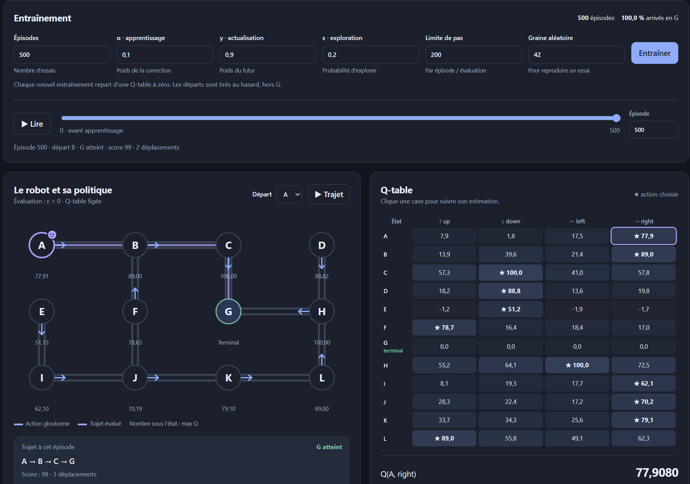
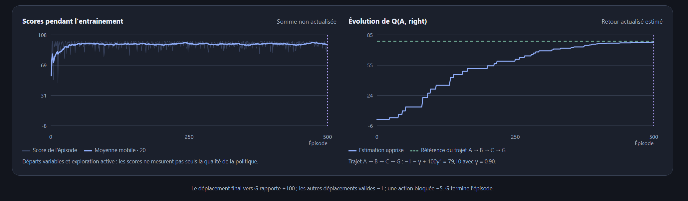

# Q-learning

Projet réalisé dans le cadre du premier TP d’IA avancée pour 3il ingénieur. Un robot apprend à rejoindre une destination dans un entrepôt en essayant des déplacements et en ajustant ses estimations à partir des récompenses reçues via du QLearning.

## Sujet

L’entrepôt comporte douze emplacements, de **A à L**, reliés par des passages. Le robot peut tenter de se déplacer vers le haut, le bas, la gauche ou la droite, mais certains déplacements sont bloqués. Son objectif est de rejoindre **G** en limitant les détours, depuis différents points de départ.

Le travail consiste à représenter cet environnement, définir les récompenses et implémenter un algorithme de Q-learning en Python. 

## Fonctionnement

L’agent conserve ses estimations dans une Q-table de **12 lignes et 4 colonnes** : une ligne par emplacement et une colonne par action. Après chaque déplacement, il corrige la valeur de l’action choisie en tenant compte de la récompense obtenue et de la meilleure valeur estimée dans l’état suivant.

Dans cette implémentation, l’arrivée en G rapporte **+100**, un autre déplacement autorisé rapporte **−1**, et une action bloquée rapporte **−5** tout en laissant le robot sur place. Atteindre G termine l’épisode, aucune récompense future n’est alors ajoutée à la cible d’apprentissage.

Chaque épisode commence à un emplacement tiré au hasard, hors G. ε-greedy choisit une action aléatoire avec une probabilité ε et exploite la meilleure estimation le reste du temps. Ici, ε reste constant pendant un entraînement. L’évaluation utilise ensuite une politique gloutonne, avec ε = 0 et une Q-table figée.

Les réglages par défaut sont de **500 épisodes**, avec α = 0,1, γ = 0,9 et ε = 0,2. La limite est fixée à 200 déplacements par épisode et la graine aléatoire à 42 pour reproduire les résultats. Tous ces paramètres sont modifiables depuis l’interface ; un nouvel entraînement repart d’une table à zéro.

## Visualisation des résultats

L’interface donne accès aux tables enregistrées après chaque épisode. Le curseur permet de revenir en arrière, la carte affiche les actions choisies et le trajet peut être animé depuis le départ sélectionné.



Les courbes permettent de suivre les scores obtenus pendant l’entraînement et l’évolution d’une valeur Q. Le score additionne les récompenses sans actualisation ; les valeurs Q prennent en compte γ. Pour le trajet A → B → C → G, le retour actualisé vaut **79,1** avec γ = 0,9. Sur cet entraînement, l’estimation de `Q(A, right)` atteint environ **77,91** après 500 épisodes.

Les scores fluctuent encore parce que le robot continue d’explorer et que les départs changent d’un épisode à l’autre. La moyenne mobile sur 20 épisodes aide à lire la tendance, tandis que les trajets évalués permettent d’observer directement les choix de la politique apprise.



## Lancer le projet

Le projet utilise Python 3 et NumPy. Depuis le dossier du dépôt :

```bash
python -m pip install numpy
python tp.py
```

Le script démarre un serveur local et ouvre automatiquement l’interface dans le navigateur. L’adresse est également affichée dans le terminal..


Projet sous [licence MIT](LICENSE).
